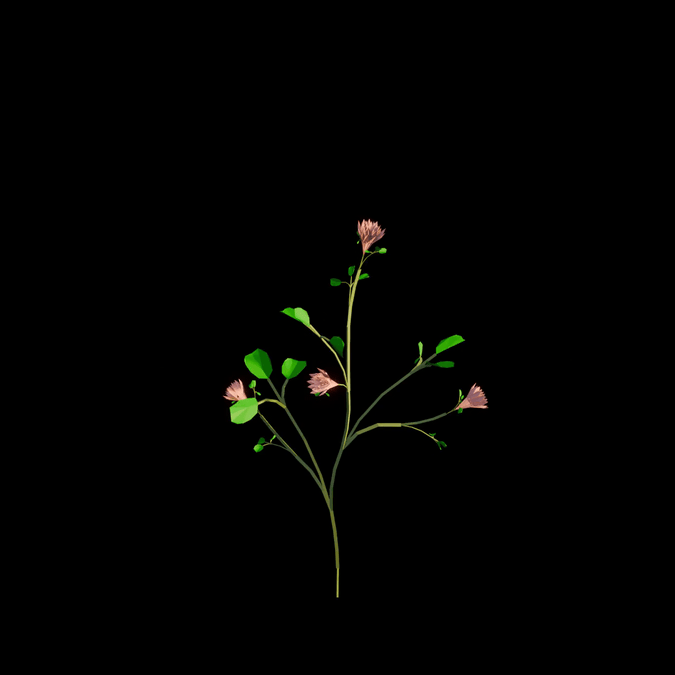
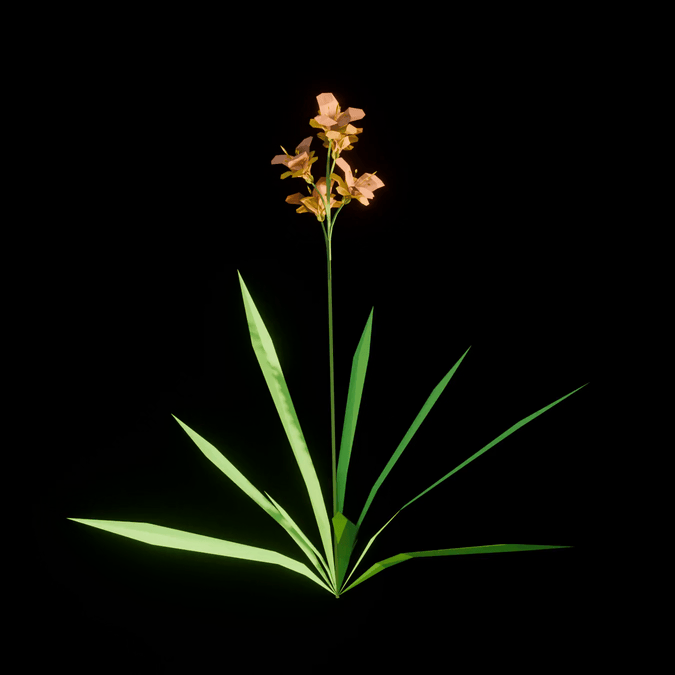
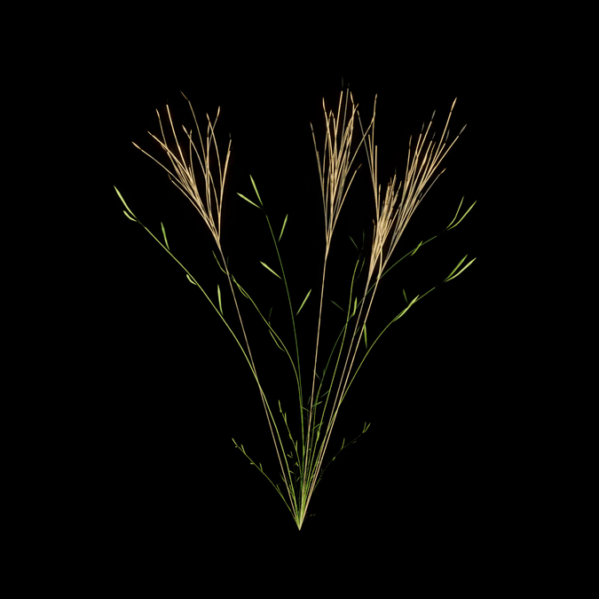

# PlantStudio-Blender ⚘

<p align="center">
  
  
  
</p>

A Blender extension that brings [**PlantStudio Botanical Illustration Software**](https://www.kurtz-fernhout.com/summary_plantstudio.html) into Blender. Create, grow, and tweak herbaceous plants (wildflowers, grasses, vegetables, garden flowers, shrubs) with a real-time wizard, cross them in a breeder, and animate their growth.

> Try the [original](https://www.kurtz-fernhout.com/download_new.html) or a WIP [browser version](https://plantstudio.com/plantstudio-js-alpha1/tests-interactive/Application-test.html) by Paul Fernhout & Synthia Kurtz.

A fair warning: I'm not a programmer. I made this add-on with the help of a coding agent as a stylized plant-generation engine for my [Gardenia Automata](https://github.com/vitvinv/digital-garden) art project, and the agent wrote most of this Readme too. For now, my plan is to recreate PlantStudio as faithfully as possible in a modern environment, with a few quality-of-life improvements.

---

## Install

1. Download [plantstudio_blender.zip](https://github.com/vitvinv/plantstudio-blender/releases/latest/download/plantstudio_blender.zip) from [Releases](https://github.com/vitvinv/plantstudio-blender/releases).
2. Drag the zip into the Blender window and click **Install**. (Or: Edit → Preferences → Add-ons → Install from Disk.)
3. Make sure "PlantStudio-Blender" is enabled, then press **N** in the 3D viewport and open the *PlantStudio-Blender* tab.

Tested on Blender 4.2 LTS and 5.x. No external Python packages.

## Quick start

1. **Load Preset** → pick a species (or a saved preset or breed), then press **Create**.
2. Select the plant in the viewport or Outliner. The panel now edits it.
3. Drag **Age (days)** or **Growth (%)** to watch it grow. Change the seed for a different shape.
4. Tweak the wizard sliders. The mesh rebuilds as you drag.
5. **Save Preset** keeps your changes for next time.

## The panel

| Box | What it does |
|---|---|
| **New Plant** | **Load Preset** (library species, your presets, saved breeds), **Save Preset**, **Create**. |
| **Plant** | Age, Growth (% of full), Seed, then eight wizard sections: Meristems, Internodes, Leaves, Compound Leaves, Inflorescence Placement, Inflorescence Drawing, Flowers, Fruits. The last three appear only once the plant can flower. |
| **Breeder** | Cross two plants into offspring (see below). |
| **Export** | Writes one JSON config per plant (`plant_id`, `species`, `seed`, `planted_date`) to the *Config export dir*, for headless or CI regeneration. |

Plants are ordinary Blender objects in the `PlantStudio Plants` collection. Delete them with **X**.

### Breeder

Like the original Breeding Room. The active plant is parent A. Select a second plant to make it parent B; with no parent B, offspring are mutations of A.

Set **Offspring** and **Breeding seed**, then press **Breed**. Offspring appear as `<parent>_breed_N`. The same parents, seed, and count always give the same offspring. **Mutation %** scales how much they differ. **Advanced** sets mutation and parent weight per section, and saves or loads the strategy.

Bred plants carry their full parameters, so they survive `.blend` save/reopen and can be edited in the wizard. **Save Preset** on a bred plant adds it to **Load Preset → Breeds**.

### Animating growth

Age is the plant's own property. Hover **Age (days)** or **Growth (%)** and press **I** to keyframe it, then scrub or play the timeline. Each plant animates on its own. To make different species finish growing together, key **Growth (%)** instead of days.

**Rendering:** use **Render Growth Animation** (it appears once a plant is animated), not Ctrl+F12. Blender's render thread can't safely regrow meshes, so Ctrl+F12 leaves plants frozen.

- Frames go to `<Output path><start>-<end>_PNG/`, then `ffmpeg` (must be on `PATH`) encodes `<Output path><start>-<end>.mp4`. Without ffmpeg you keep the PNGs.
- **Esc** cancels and offers to delete the frames rendered so far.

## Where your files go

Presets and breeds live outside the add-on, so updating never wipes them.

| What | Where |
|---|---|
| Presets | `~/.plantstudio/presets/<category>/<name>.json` |
| Breeds and strategies | `~/.plantstudio/breeds/` |
| Exported configs | *Config export dir* in the panel, else `$PLANTSTUDIO_PLANTS_DIR`, else `~/.plantstudio/exports` |

---

## For developers

The simulation core (`plantstudio_blender/core/`) has no Blender dependency. It runs on Python 3.11+ for batch generation, tests, or server-side use. Run the tests with:

```bash
python -m pytest plantstudio_blender/tests/ -q
```

<details>
<summary>Project layout</summary>

```
plantstudio_blender/
├── core/               # Headless simulation and drawing (no bpy)
│   ├── plant.py        # whole-plant growth, biomass allocation
│   ├── meristem.py     # branching, phytomer/inflorescence creation
│   ├── internode.py, leaf.py, inflorescence.py
│   ├── turtle.py       # 3D turtle graphics -> mesh buffer
│   ├── draw.py         # high-level drawing dispatch
│   ├── params.py, pla_parser.py, tdo_parser.py, normalize.py
│   ├── factory.py      # create_plant() / grow_species()
│   ├── breeding.py     # breeder: inherit() + strategy
│   ├── rng.py          # deterministic LFSR matching the original
│   └── ...             # math, growth %, species library, defaults
├── ui_panel.py         # N-panel
├── operators.py        # create, load, save, breed, render, export
├── wizard.py           # sliders <-> parameters, live rebuild timer
├── scene_bridge.py     # mesh build, materials, collections
├── animator.py         # age/growth sync, frame-change handler
├── data/               # bundled .pla species + 3D object library (.tdo)
└── tests/
tools/                  # validation and comparison scripts (not shipped)
scripts/                # maintainer scripts (not shipped)
```

</details>

<details>
<summary>How plants grow</summary>

PlantStudio uses a meristem-driven biomass model:

1. Apical and axillary meristems accumulate biomass each day.
2. When a meristem crosses a threshold, it creates a phytomer: an internode, a leaf, and axillary buds.
3. Branching is probabilistic, controlled by `branchingIndex`, `branchingDistance`, `branchingAngle`, and the sympodial/monopodial setting.
4. Biomass allocation follows an S-curve toward `ageAtMaturity`. After flowering starts, a fraction goes to reproductive structures.
5. Inflorescences form on reproductive meristems. Flowers grow, open, and may set fruit.
6. One seeded random generator drives every stochastic decision, so the same seed gives an identical plant.

The parameter registry maps field IDs (e.g. `kGeneralAgeAtMaturity`) to access strings (e.g. `pGeneral.ageAtMaturity`). `.pla` files reference parameters by field ID, so new parameters don't break old files.

</details>

<details>
<summary>File formats</summary>

| Format | Purpose |
|---|---|
| `.pla` | Plant species definition. Latin-1 text: `[Species Name] start PlantStudio plant <v2.0>`, then `Param Name [kFieldID] =value`. Can embed custom 3D parts. |
| `.tdo` | 3D object library. `Name=…`, `Point=x y z`, `Triangle=i j k` (1-based). |
| preset `.json` | `{name, category, base_species, knobs}` |
| breed `.json` | `{name, parents, strategy, params, day}`: the offspring's full parameter set. |
| config `.json` | `{plant_id, species, seed, planted_date}` (ISO date). |

</details>

---

## Plans

- [x] Make sure every plant matches the original library
- [x] Add a plant breeder
- [x] Add some human touch to this page
- [ ] Polish the UI
- [ ] Import external `.pla` files
- [ ] Optimize materials
- [ ] Add the decimation algorithm for headless mode

## Compared with the original

| Original feature | Status |
|---|---|
| Plant breeder (Breeding Room) | Present |
| Wizard | Present (8 sections) |
| Species libraries | Present (bundled `.pla` and `.tdo`) |
| Time series / animation | Present (keyframe age or growth %) |
| External `.pla` import | Missing. Natural next step; it would unlock ~100 free `.pla` files. |
| 3D object (TDO) editor | Missing. Shape pickers only. |
| Hints and help | Missing. The parameter hint strings could become tooltips. |
| Plant statistics | Missing (low priority) |
| Multi-plant arrangement | Mostly covered by Blender's own tools |
| DXF/POV/BMP export, image hoses | Superseded by Blender |

## License

GPL-3.0, see `LICENSE`. The original PlantStudio source (Delphi) is © Kurtz-Fernhout Software, used with permission / under its original freeware terms. The Python port and Blender addon are derivative works.
